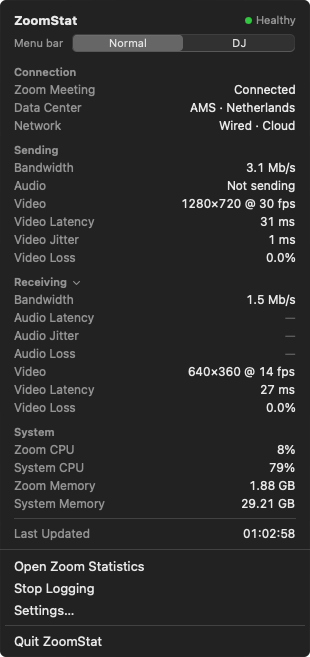

# ZoomStat

A small macOS menu bar app that shows the live connection statistics of your current Zoom meeting — the same numbers as Zoom's own **Settings → Statistics** panel — so you can keep an eye on the quality you are **sending** without digging through Zoom's settings.

<p align="center">
  
</p>

The menu bar itself shows a compact summary, for example:

```
↑3.0M · V↑720p 29fps          Normal profile: send bandwidth, send resolution and fps
A↑24ms 2ms 0.0%               DJ profile: audio send latency, jitter and packet loss
```

## Features

- **Sending first.** Bandwidth, audio latency / jitter / loss, and video resolution, frame rate, latency and loss for what you send. Receiving is one click away.
- **Menu bar profiles.** Pick any combination of 26 values and save them as named profiles (e.g. *Normal* and *DJ*); switch from the popover.
- **Connection status.** Healthy / Degraded / Poor, judged on what you send by default, with configurable thresholds.
- **Alerts.** Optional notifications when high latency, jitter, packet loss, low frame rate or high CPU/memory persist for a set time.
- **Logging.** Optional per-meeting CSV and JSON Lines logs in `~/Library/Application Support/ZoomStat/Logs`.
- **Lightweight.** About 1% CPU and ~60 MB of memory. No Dock icon; launch at login supported.

## How it works

Zoom doesn't expose meeting statistics through a public local API. ZoomStat reads Zoom's own Statistics panel through the macOS **Accessibility API** and rotates its tabs (Overall, Audio, Video, Screen sharing) about once per second. The Settings window can stay minimized or sit on another display; rotation pauses while you are using it yourself.

It is strictly read-only towards the meeting:

- no code injection, patching or memory access
- no network interception
- no OCR or screen capture
- nothing touches your meeting — ZoomStat only opens Zoom Settings on request, selects Statistics and switches its tabs

CPU, memory, network type, proxy and Zoom version also come from native macOS APIs, so they keep working when the Statistics panel is closed.

Logs contain technical values only — never participant names, chat, audio, video or meeting content.

The investigation behind this approach (logs, databases, sockets, shared memory and more) is documented in [RESEARCH.md](RESEARCH.md).

## Requirements

- macOS 14 Sonoma or later (tested on macOS 15.7, Apple Silicon)
- Zoom Workplace for Mac (tested with 6.5.7, English UI)
- Xcode or the Swift 5.9+ toolchain to build

## Install

```zsh
git clone https://github.com/chicksonspeed/ZoomStat.git
cd ZoomStat
./scripts/build-app.sh
cp -R build/ZoomStat.app /Applications/
open /Applications/ZoomStat.app
```

Then allow **ZoomStat** under **System Settings → Privacy & Security → Accessibility**.

In a meeting, choose **Open Zoom Statistics** from the ZoomStat menu (or *Read Statistics in Background* in the popover) once; you can minimize the window afterwards.

> **Rebuilding:** without a signing certificate the app is ad-hoc signed, and macOS treats every rebuild as a new app. Remove ZoomStat from the Accessibility list and add it again after each rebuild, or set `ZOOMSTAT_SIGN_IDENTITY` to a code-signing identity so the permission sticks.

If the menu bar item is hidden behind the notch or a full-screen meeting, open ZoomStat again from Spotlight or Finder to get the same view in a regular window.

## Command-line tool

```zsh
swift build --product zoomstat-cli
.build/debug/zoomstat-cli              # prints statistics every second
.build/debug/zoomstat-cli --once       # one complete sample
.build/debug/zoomstat-cli --json --log # JSON output + CSV/JSON logs
swift test
```

## Project layout

```
Sources/ZoomStatCore/        Model, provider, parser, health, alerts, logging
  Zoom/ZoomUILabels.swift    Every Zoom version/language-dependent string
  Zoom/…                     Accessibility access to Zoom's Statistics panel
  System/SystemMetrics.swift Native CPU, memory, network and proxy readings
Sources/ZoomStat/            SwiftUI menu bar app
Sources/zoomstat-cli/        Command-line proof of concept
research/                    Accessibility probes and captured panel fixtures
```

If a Zoom update changes the Statistics panel, dump its structure with `research/axdump Settings 14` and update `ZoomUILabels.swift`.

## Limitations

- Zoom's Settings window must stay open on the Statistics page (minimized is fine).
- Labels are matched in English; other Zoom languages need their strings added to `ZoomUILabels.swift`.
- Video bitrate isn't shown by Zoom 6.5, so ZoomStat doesn't show it either.
- Audio send values are only reported while your microphone (or shared computer sound) is live.

ZoomStat is an independent project and is not affiliated with or endorsed by Zoom Video Communications.
